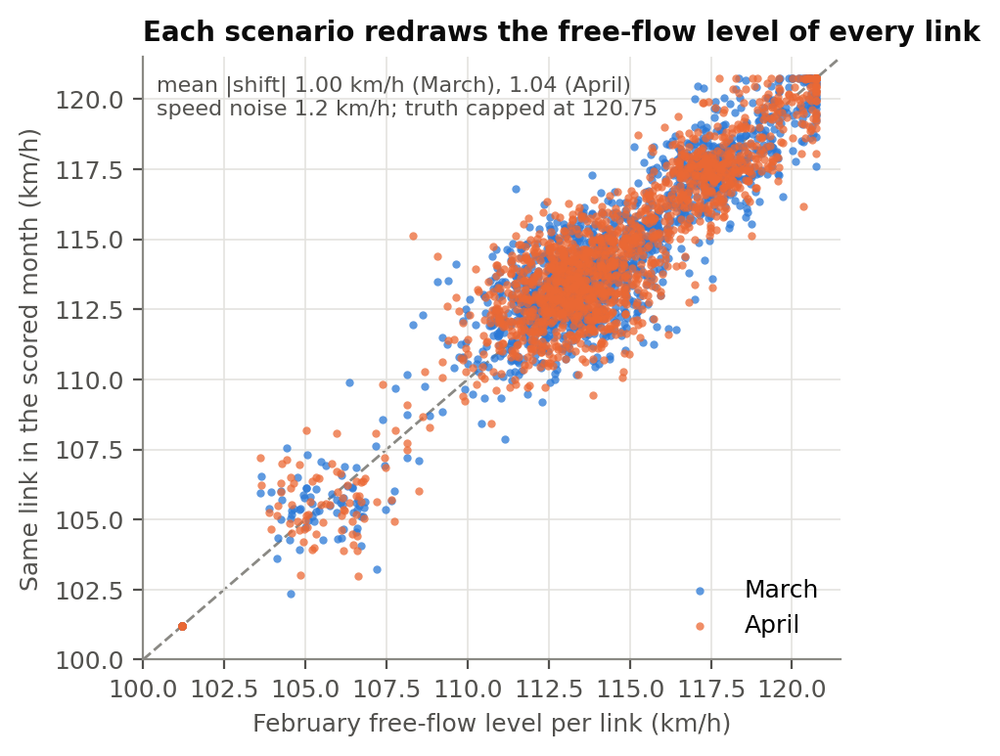
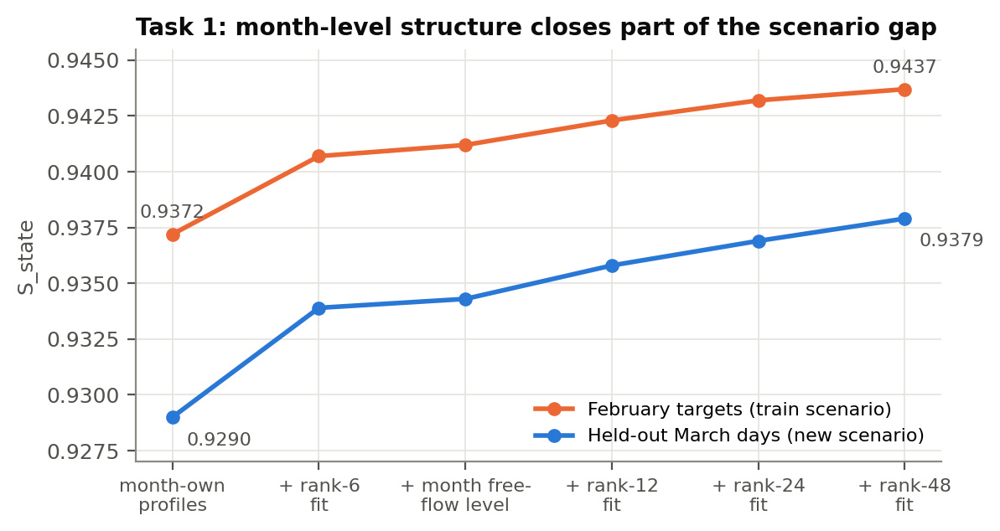
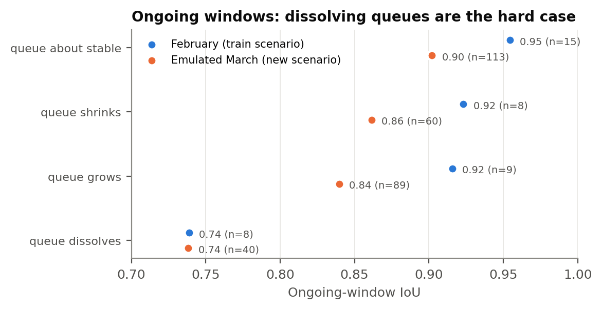
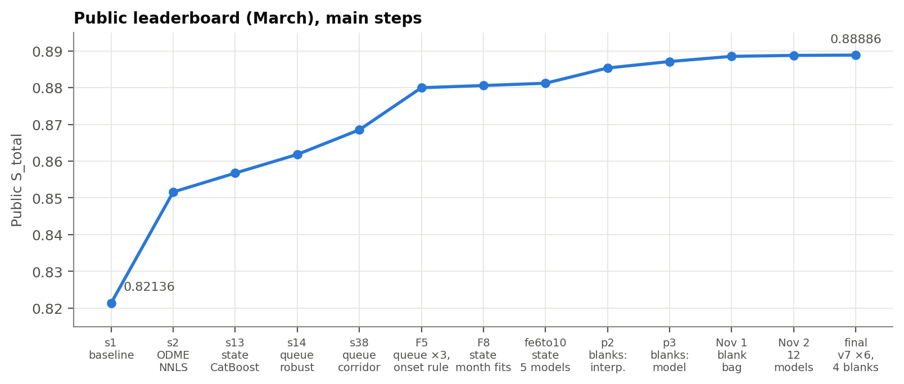

# TrafficFlowBench 2026 — Team Abderahmane_tb

*Final version (Nov 7, 2026). Numbers marked [LB] are public-leaderboard (March) scores of single-change submissions;
the four task scores add linearly in S_total, so a submission that changes one component measures that component
exactly.*

## 1. Summary

The release contains nine training months generated from one traffic scenario and two scored months (March =
validation, April = private) generated from **new, independent scenario seeds** (organizer configuration
`scenario_contract.seed_policy`). We measured how strongly this matters: the share of time each link is queued
correlates 0.98–1.00 between training months, but only 0.54–1.00 between any training month and March or April,
and March–April are no more alike than February–March. Our method is therefore organised around one question per
task: *what transfers to an unseen scenario, using only information the rules allow?* A second structural fact turned
out to matter as much: after every official queue-forecast origin, the scored months hide the whole corridor for 90
minutes, and the hidden cells that are Task 1 targets resemble no ordinary training row; a model trained on
emulated copies of these blanks was our largest single Task 1 gain.

| Task (weight) | Final method | Key evidence |
|---|---|---|
| 1 State (0.35) | Weighted mean of twelve residual gradient-boosting models (8 CatBoost, 2 LightGBM, 2 XGBoost; the five built on the final feature set weighted 6, the others 1) over a time-interpolation base; features include month-own profiles, low-rank completions of the month (ranks 6–48), the month's own free-flow level and an on-ramp jam sensor; trained on the train months + self-supervised rows of the scored months. Inside the 90-minute queue-window blanks: a weighted mean of four dedicated models trained on emulated blanks (.1 / .1 / .1 / .7). Speed clipped at the generator's cap | held-out March days 0.929 → 0.938 from the month-level features; blank cells 9.7 → 5.5 km/h on emulated blanks; [LB] ≈ +0.018 S_total over a LightGBM baseline, +0.0066 of it from the blank cells |
| 3 Physics (0.15) | Scored on the Task 1 answer; light time smoothing of the predictions inside runs of consecutive hidden cells and of the blank speeds, because the conservation score charges the total variation of the error along time | the variation model predicted the blank-smoothing gain exactly ([LB] +0.00004); otherwise the residual sits at the measurement-noise floor |
| 2 Queue (0.30) | Shift-robust LightGBM (3 seeds) with corridor-state features and the documented window-selection rule; onset = links with probability ≥ 0.5 × the window maximum; ongoing = probability ≥ 0.55 (April), plus a remote-queue head for links far from the current queue | train-split shift test; [LB] ongoing IoU 0.774 → 0.860 → ≈ 0.880, onset 0.770 → 0.814 over a prior-based model |
| 4 ODME (0.20) | Converged non-negative ridge (λ = 0.05) on each split's own counts and prior | two [LB] probes consistent with S_ODME ≈ 0.99 |

## 2. Task 1 — state reconstruction

**Model.** For each target cell we predict residuals of speed and per-lane flow over a time-interpolation base with
CatBoost (RMSE, depth 8, 12 000 iterations, GPU). Features: time neighbours (±1…3, ±6, ±12 steps), the nearest
observed values in both directions and their gaps, up/downstream neighbours (1–3 links), observation quality,
static link attributes, train-wide profiles, and **month-own profiles** computed from the scored month's released
(masked) layer. Training rows reproduce the official masking: train targets are the train split's masked cells.

**Why month-own profiles.** The February holdout cannot rank models for March/April — February runs on the
training scenario, where month-own and train-wide profiles coincide. We built a proxy that can: in a scored month
we hide 15 % of the *observed* eligible cells (the official mask is i.i.d. per cell), rebuild every feature from the
doubly-masked layer and score the hidden cells. On this proxy the month-own profiles add +0.006 (March) and +0.012
(April) S_state, while February sees no difference.

**Self-supervised domain adaptation.** Task 1 is offline, so the scored months' own observations are legitimate
training data. Adding their pseudo-target rows (weight 2) teaches the model when the month-own profiles should
override the train-wide ones — something the train months, which share one scenario, cannot teach. On held-out
days of the scored months: 0.9306 / 0.9327 vs 0.9236 / 0.9252 (March / April); February unchanged (0.9458).
[LB] LightGBM v1 → this model: +0.0052 S_total.

**What the new scenario changes for Task 1.** Each link runs at its own free-flow speed level, which is stable to
0.03 km/h between training months but moves by 0.6–1.3 km/h on average (up to 5 km/h) in March and April — as large
as the speed noise (1.2 km/h). A model trained on the training months only treats the training level as exact: its
per-link free-flow error correlates 0.98 with this shift, and correcting the shift alone lifts its March proxy score
from 0.918 to 0.925. With month-own profiles and self-supervised rows the model follows the month's own level
(a post-hoc correction then no longer helps: 0.9305 → 0.9307 at best), which is the main reason those rows help.

**Where the remaining Task 1 error is.** On the training scenario the model is close to the measurement noise
(February holdout: speed RMSE 1.38 km/h against 1.2 km/h noise, flow 29.7 veh/h/lane). In the scored months the
loss concentrates on congested corridors (held-out March days: D7_I405_N 0.913, D7_I210_W 0.926 against 0.94–0.95
elsewhere). There, jammed cells — 2–10 % of all cells — carry about half of the squared speed error, and 73 % of
that jam error comes from jammed cells predicted as free-flowing, i.e. from the *edges* of a jam in time and space,
not from wrong speeds inside it (cells correctly placed inside a jam are within 2–3.6 km/h). A queue's tail moves
upstream over a few links within one 5-minute step, so when the neighbouring cells are themselves hidden the edge
is genuinely uncertain. The released on-ramp flows help a little: an on-ramp's flow collapses in the same step its
mainline link jams (it flags 35–93 % of jammed cells), but only 12–55 % of cells have an observed attached on-ramp.
Finally, the generator caps speed at 120.75 km/h (2–18 % of a corridor's observed cells sit exactly there); we clip
our speeds at the cap, which can only reduce the error.

**Cells no training row resembles: the blanks after the queue windows.** In March and April every link of a queue
corridor is hidden for the 90 minutes after each official Task 2 origin (T+5 … T+90 min). The day's mask share of
those cells are Task 1 targets (e.g. 42 % of the eligible hidden cells of D7_I10_E in March; the others are not scored
and enter the physics score as truth): 1.9 % of all targets, 2–2.5 % on the eight queue corridors (128 000 cells in
the two scored months).
Nothing in training looks like them. No neighbour in time or space is observed, and a month low-rank fit has no data in
those rows, so its row factor shrinks to zero and the fit falls back to each link's monthly mean. Models trained on
ordinary rows extrapolate there: our CatBoost and LightGBM members disagree by 6–10 km/h and ~80 veh/h/lane inside
the blanks, against 0.2–0.6 km/h elsewhere.

We emulated such blanks where the truth is known. At the origins the reverse-engineered selector picks in March and
April, we hid the 18 following slots on every link, rebuilt every feature from the blanked layer and scored predictors
on the hidden observed cells (Task 1 is offline, so a scored month's own observations are legitimate truth here). On
these emulated blanks the main models are no better than plain time interpolation for speed (8–11 km/h) and far worse
for flow (200–266 veh/h/lane against 90–109).

A dedicated LightGBM model, trained only on emulated-blank cells, uses:
- the time interpolation between the blank's edges and the edges of the neighbouring links;
- the on-ramp jam signal inside the blank (ramp flows are released throughout, and ramp rows at the same moment are
  legitimate for this offline task);
- the corridor's demand ratio to the month profile just before and after the blank, interpolated across it;
- the position in the blank and the window's condition.

Training data matters more than model size here. Cross-validated by day parity on 1.4 million emulated-blank cells:

| blank model | speed, km/h (March / April) | flow, veh/h/lane |
|---|---|---|
| time interpolation (no model) | 9.69 / 10.26 | 98.7 / 97.6 (with the corridor demand) |
| all emulated windows of March and April | 6.32 / 6.70 | 83.0 / 80.8 |
| + larger trees | 6.24 / 6.64 | 82.9 / 80.8 |
| + emulated blanks of the training months (history revealed as in the release) | **5.72 / 6.29** | **80.2 / 79.1** |

For flow, the model's correction is applied at 70 % on top of the corridor-demand interpolation, which halves its
variance. Onset windows are easy (4.2–4.8 km/h: by construction the corridor is queue-free for the first 25 minutes);
ongoing windows carry the jams (6.6–7.2 km/h).

[LB] Replacing only these 2 % of the cells moved the public score more than any other Task 1 change: CatBoost mean →
LightGBM 0.88120 → 0.88373; → interpolation 0.88535; → blank model 0.88711. The final blank answer is a weighted mean
of four such models with different seeds and data shares; the largest, trained on twice the training-month blank
rows (−3 % speed error in the cross-validation, 5.47 / 6.11 km/h March / April), carries 0.7, the weight an
out-of-fold mix test chose, and the speeds are smoothed ±1 slot along time (Section 3).

**Low-rank completion of each month.** In this generator a link's flow is its own scale times a day curve that the
whole corridor shares, plus 2.8 % white noise; the predictable part of a hidden cell is therefore estimated far more
precisely from hundreds of links observed at the same moment than from its few neighbours. For every month we fit
the masked layer, unfolded as (day × slot) × link, with alternating ridge least squares on the observed cells only
(ranks 6, 12, 24 and 48) and give the model the fitted value of the cell plus how its observed time neighbours
deviate from the fit. The fit is recomputed on whatever layer the features come from, so a self-supervised row never sees
its own value. Like-for-like (same rows, LightGBM), scored on held-out March days:

| features | March held-out | February targets |
|---|---|---|
| month-own profiles (cb3) | 0.9290 | 0.9372 |
| + rank-6 month fit | 0.9339 | 0.9407 |
| + month-own free-flow level per link | 0.9343 | 0.9412 |
| + rank-12 month fit | 0.9358 | 0.9423 |
| + rank-24 and rank-48 month fits (feature v7) | 0.9379 | 0.9437 |

(The last two rows come from a second run of the harness on feature v4 + fits: rank 12 0.9358 / 0.9423, + rank 24
0.9369 / 0.9432, + rank 48 0.9379 / 0.9437; rank 48 alone 0.9376.) Finer fits keep helping because the month matrix
mixes a smooth demand surface with jams that occupy a few links for a few hours; each extra rank captures more of
the recurring jams of that scenario.

Settings that did *not* help on the same harness: weighting the self-supervised rows more heavily (weight 2: 0.9357,
4: 0.9354, 8: 0.9348; 0.5–1.5 within ±0.0002), a second boosting stage on the month's own rows only (0.9356 / 0.9355),
a model trained on the month's own rows alone (0.9322) or its blend with the joint model (0.9356), and jam-edge
features (previous/next observed state of the neighbouring links, time since/until an observed jam, space-time
diagonals: −0.0002 to +0.0003, i.e. noise).

[LB] CatBoost with the rank-6 fit, everything else equal to the previous final: public 0.87998; with all four
additions (feature v6): 0.88058. The proxy overstates the real gain (+0.0019 S_state on the proxy, +0.0004 on the
leaderboard): its rows hide 15 % more cells than the official targets, so month-level structure matters more there.

**Averaging learners.** Models that differ only in their feature set make partly independent errors at jam edges;
the mean of the CatBoost models with features v4, v5 and v6 gains another +0.00045 ([LB] 0.88103).

**Final ensemble.** Twelve members: eight CatBoost (feature versions v4–v7; the three v7 members with 24 000
iterations and different seeds / training rows), two LightGBM (v6, v7) and two XGBoost (v6, v7), all on the same
training rows (1.2 million train-split targets per corridor + the self-supervised rows of March and April). The five
v7 members are the strongest on the February holdout (0.9489–0.9502 against 0.9477–0.9489), so they weigh more in
the mean; the weight was set on the leaderboard in single-change steps that changed nothing else ([LB] v7 weight
2 → 3: +0.00005, 3 → 4: +0.00002, 4 → 6: +0.00002, v7 members only: −0.00001), i.e. the older members still add
diversity but little. Adding two more LightGBM seeds of v7 lost −0.00006 (they are too similar to lg2). Inside the
blanks the dedicated blank models replace the ensemble, and run smoothing (Section 3) is applied last.

## 3. Task 3 — physics consistency

S_phys = (S_FD + 2·S_LWR)/3 is computed from the Task 1 answer (density = q/v, N = density × length). S_FD is ≈ 0.985
for any reasonable answer. S_LWR penalises |ΔN_sub − ΔN_true| on transitions touching a predicted cell; the reference
flux is projected onto the released observations, so reproducing the observations exactly would score 1; what is
charged is the total variation in time of the error N_sub − N_obs around each predicted cell. We measured that the density of a
cell cannot be predicted from its neighbours in time or space better than 2.5–4 % (independent observation noise),
which puts S_LWR near 0.5 for every method that predicts the underlying state; physics-specific post-processing
can therefore only remove what the reconstruction adds on top of that floor (see the last paragraph).

**Why the conservation score behaves this way.** With the organizer's boundary flux the true field satisfies the
conservation equation exactly, so the residual of a submission is |ΔN_sub − ΔN_true| summed over the transitions that
touch a predicted cell: an isolated predicted cell with accumulation error e costs 2|e|, a run of predicted cells
costs the total variation of its errors. Two consequences follow. First, the score is an L1 measure of *density*
errors, and density is large exactly where speed is small: a jammed cell predicted as free-flowing has a density
error three to five times its free-flow density, so the jam edges that dominate the Task 1 speed error (Section 2)
dominate the conservation residual as well — every Task 1 gain is amplified here (on February, replacing LightGBM by CatBoost
raised S_state by 0.005–0.007 and S_phys by 0.036). Second, a smooth reconstruction cannot follow the independent
measurement noise of the truth (2.8 % on flow, 1.2 km/h on speed), and the noise alone — not any physics violation
of the model — sets the floor. We also tried to give the physics score its own estimate: a direct L1 density model
whose density was imposed by rescaling flow (or split between speed and flow) lowered S_LWR on February
(e.g. 0.616 → 0.602 on D7_I210_W) and cost S_state, so the separately optimal speed and flow models were kept.

**Jitter between neighbouring predictions.** The total-variation form has a direct consequence for runs of
consecutive predicted cells on a link (half of the targets in the 50 % regime): the score charges every change of the
error from one slot to the next, so independent jitter between two neighbouring predictions costs S_LWR even when each
prediction is accurate on its own. Our March predictions change by 2.5 % of the accumulation per step inside such runs,
and the jitter is shared by all members (single members 2.6–2.7 %, so averaging does not remove it). Pulling each
prediction 15 % of the way towards the mean of itself and its neighbours in the run (speed and flow; the blank cells
are left alone) raised the February surrogate on all ten corridors (+0.0020 S_LWR, S_state unchanged, ≈ +0.0002
S_total), while full smoothing lost S_state on congested corridors and smoothing only free-flow cells lost the gain
(it comes from congested cells, where the accumulation is large). On March it added only +0.00001: a single
February model in its own scenario has small errors, so jitter is a large share of its residual, whereas under the
scenario shift the errors themselves dominate. The same total-variation estimate predicted the blank-cell speed
smoothing exactly (+0.000037 estimated on emulated March / April blanks, +0.00004 measured).

## 4. Task 2 — queue forecasting

### 4.1 The documented selection procedure
We re-implemented the window selector from `config/synthetic_release_v1.json` (onset windows first, earliest
qualifying origins, ≥ 360 min spacing from every chosen window, ≥ 70 % history coverage, queue in the horizon,
persistence IoU ≤ 0.9 for ongoing windows). It reproduces 73 / 80 official training windows; on official-like
February windows the persistence baseline scores 0.6045, the public leaderboard's 0.603. Two consequences used by
our models, both conditioning only on origins ≤ T (allowed by the organizers):
* **Onset windows:** the queue appears exactly at T+30; we predict only that step.
* **Ongoing windows:** if origin T−5 was allowed and already qualified, the selector skipped it only because its
  persistence IoU exceeded 0.9 — the queue is stable through T+25 and changes at T+30 (63 % of training windows).
  We pass this as features (sel_stable1, sel_fresh1, sel_run, sel_vis_age).

### 4.2 Scenario shift
Location priors (where queues start, when links are queued) dominate a model trained on the train scenario: 87 %
of the onset model's gain came from them. **Train-split shift test:** on official-like February windows whose
location priors are rolled to wrong places, that model collapses (ongoing IoU 0.889 → 0.528, onset 0.867 → 0.004).
Remedies, all fitted on the train split only:
* prior-shift augmentation — in half of the training windows the priors are rolled along the corridor;
* no link identity (panel id, link position);
* month-own features (queue activity on earlier days of the same month and earlier the same day), with the
  training windows' month history cut to a random 0–6 days so that they resemble the official windows, which sit
  mostly on the first days of their month (median day 3–4; onset windows up to day 10, ongoing windows up to day 20
  across the three splits — the few later windows see a longer month history than this training cut, a mismatch
  we did not have time to remove).
Under the shift test the robust recipes keep 0.87–0.88 (ongoing) and 0.75–0.86 (onset).
[LB] ongoing IoU 0.774 → 0.836 with the robust recipe.

### 4.3 Corridor state features
What transfers to a new scenario is the road and the traffic on it at T, not where jams used to be. We add, per window,
the corridor's vehicle count relative to its critical count (Σ k·L over links), its 30-minute trend and its deviation
from the last hour, the queued length at T, and for every link the density of its neighbours and the mean density
(1, 3 and 6 km), load and density trend (3 km) upstream and downstream, with their rank and z-score within the window.
In this generator the number of vehicles on a corridor sets its jam length, and a high density just downstream of a
bottleneck is the earliest sign that it will break down. All of them are computed from features that use rows ≤ T.
Train evidence: official-like February ongoing 0.881 → 0.889 / onset 0.855 → 0.870 (one seed); shift test 0.872 →
0.879 / 0.754 → 0.789. [LB] ongoing IoU 0.836 → 0.852, onset 0.742 → 0.798 (one seed, v11 → v13).

### 4.4 Final ensemble and decision rule
The corridor recipe (level 2) × three seeds, probabilities averaged. Ongoing windows: every link with P ≥ 0.5 at a
step is queued. February official-like windows: ongoing 0.896, onset 0.892; Feb holdout (208 onset windows): 0.911.
[LB] ongoing IoU 0.860.

**Onset under a scenario shift: hedge over candidate bottlenecks.** An onset window asks *where* a queue will appear at
T+30. When location knowledge is partly wrong, the probability mass spreads over several candidate bottlenecks and
a fixed threshold often keeps only one of them. We therefore mark every link whose probability is at least half of
the window's largest one (rule "rel 0.5"). Train-split evidence (location priors rolled to wrong places in 0 / 50 /
100 % of the windows, three seeds):

| rule | Feb official-like 0 / 50 / 100 % | Feb holdout (208) 0 / 50 / 100 % |
|---|---|---|
| P ≥ 0.5 | 0.887 / 0.843 / 0.770 | 0.911 / 0.884 / 0.863 |
| P ≥ 0.5 · max | 0.878 / 0.849 / 0.802 | 0.904 / 0.888 / 0.877 |

The rule costs < 0.01 when the priors are right and gains 0.01–0.03 when they are not, which is the situation of
a new-scenario month; it is chosen on these train-split tests for March windows and confirmed on March evidence for
April windows (emulated March windows 0.602 vs 0.584; [LB] onset IoU 0.792 → 0.814). With 40 onset windows per scored
split, each window carries 1/80 of S_queue (0.00375 of S_total per unit of IoU), so leaderboard differences of
±0.02 onset IoU are close to noise and
were never used alone.

**Ongoing threshold for April.** On the train-split tests the ongoing IoU peaks at a threshold of 0.55 (February
held-out windows 0.8790 against 0.8786 at 0.5 and 0.8781 at 0.6; emulated March 0.8541 / 0.8539 / 0.8529), too small
a difference to revisit the March setting. Two public probes measured it on March: 0.55 [LB] +0.00088 over 0.5 (35
cells in 16 windows), 0.6 a further +0.00017, below the +0.0003 we had fixed in advance as the bar for going further.
The April windows of both finals use 0.55; their March windows keep 0.5. The largest remaining ongoing error is
links queued at T that clear before T+30 (fixing them alone would add 0.005–0.007); a separate threshold of 0.65
for links queued at the origin gained +0.0001 on both the February held-out and the emulated-March windows and
[LB] +0.00021 (0.89190 → 0.89211), so the April windows of both finals use it.

**Remote queues.** The ongoing model scores only candidate links — within 30 links of a link queued at T, or queued
somewhere in the history — which keeps its training rows informative. An independent review of our code (Nov 6)
pointed out the price: a second queue that forms away from the current one can never be predicted. 44 of 303
February held-out ongoing windows contain such a remote queue (emulated March: 51 of 302), and predicting all of
them would add 0.0038 (0.0045) to S_total. A dedicated head — LightGBM with the inputs and the shift-robust recipe of
the main model, fitted only on the remote link-steps of the training windows (1.22 M rows, 0.22 % queued, the step as
an input, three seeds) — marks a remote link at a step when its mean probability is at least 0.5. Train-split
evidence: February held-out windows +0.0025 S_total (37 windows better, 6 worse; flat for thresholds 0.4–0.7);
emulated March +0.0012 (27 / 3). Its strongest inputs are the link's own queue activity earlier in the month,
z-scored within the window: remote queues recur at the scored month's own bottlenecks. Its probabilities are nearly
all-or-nothing — on the official windows it adds 32 cells in 4 of the 40 March and 33 cells in 5 of the 40 April
ongoing windows, and any threshold from 0.3 to 0.7 changes fewer than 10 of them. [LB] +0.00216 S_total (0.88974 →
0.89190, both with the 0.55 threshold), about +0.14 IoU in each of the four March windows it touched; both finals use
it for April. (As a second opinion on onset windows the same head loses: emulated March −0.0005 to −0.015 — it was
fitted on windows that already hold a queue elsewhere.)

### 4.5 Error analysis

`solution/t2_error_analysis.py` scores the final recipe on February official-like windows (training scenario, models
fitted without February) and on emulated March windows (a new scenario; used for April decisions only).

* **Onset.** In February the predicted set touches the true queue in 95 % of the windows (IoU 0.92 when it does);
  in a new scenario this falls to 89 % (IoU 0.68). The misses are wrong bottlenecks: an onset window starts at a
  moment when no link is queued anywhere in the history, so where the jam forms must be inferred from where density
  is building up and from where jams formed on earlier days of the same month — and the scored months contain
  incidents at new places. The relative rule predicts about four links against two to three true ones: it buys
  coverage of the alternative bottlenecks at the price of a larger union when the first guess is right.
* **Ongoing.** IoU depends on what the queue does over the half hour (Figure 5): about stable 0.95 / 0.90 (February /
  new scenario), shrinking 0.92 / 0.86, growing 0.92 / 0.84, dissolving 0.74 / 0.74. Windows that the selection
  procedure marks as stable through T+25 score 0.98 / 0.92, the others 0.83 / 0.78. A queue that dissolves within 30
  minutes gives little warning at T (the same score in both scenarios suggests that this is a limit of the
  information at T rather than of scenario transfer), so its end is the least predictable event of Task 2.
* **Where versus how far.** Two oracle experiments separate the error types (February held-out windows, models
  fitted without February). *Ongoing:* keeping the model's ranking of the links but giving it the true number of
  queued links at each step would raise the window IoU from 0.879 to 0.923 (emulated March 0.854 → 0.879), so the
  ongoing error is about *how far* the queue extends, not *where* it is. That number is not forecastable from data
  at T: a window-level model of it (predicted count trajectory, queued count at T and its 30-minute change, selection
  flags, time of day; leave-one-corridor-out) is less accurate than counting the links with P ≥ 0.5, and a
  queue-balance estimate (arrivals above the tail minus discharge at the head) explains none of the remaining error
  (correlation −0.04), while the model's own predicted change already follows the true change (correlation 0.96).
  What is left is the demand that arrives after T. *Onset:* the opposite holds — the relative rule beats the same
  true-count oracle (0.904 against 0.831 in February, 0.602 against 0.555 on emulated March), because the true
  queue is often the second- or third-ranked candidate; predicting about one link more than the truth is the right
  hedge on *where*.

### 4.6 Negative results
Expected-IoU decoding, per-step thresholds, filling one-link gaps, leave-one-day-out priors, a minimum
speed-ratio onset rule (onset links run at free speed until the breakdown), and same-month recurrence of onset
locations from the masked layer (IoU 0.18–0.27) did not help.

**Blank-filled month calendar (tested on Nov 5, not used).** The month features of a window read the queued state
of the earlier days of its month, and in the scored months those days contain the 90-minute corridor-wide blanks of
the earlier official windows — exactly over their queue periods (34–49 % of a window's earlier days have a blank over
the block that its main month feature reads; the training months have no blanks). We filled the blanks with a
classifier fitted on the training months (ramp flows inside the blank + the mainline state at its edges; on held-out
February blanks it recovers the queued cells with IoU 0.90, against 0.51 for carrying the edge state across) and
recomputed the month features. The forecasts barely moved: inserting the blanks into February windows changes the
onset IoU by +0.001 to +0.002 and filling them back by −0.004 to +0.001; on emulated March windows the fill is
neutral (onset −0.002 to +0.002, ongoing −0.001 to −0.003). A blank hides every link alike, so the within-window
z-scores and ranks of the month features that the model actually uses survive it — a robustness that the training
months never tested, but which the model has. No submission was spent on it.

**Structured onset decoding (tested on Nov 5, not used).** The relative rule often marks links in two or more
separate places (40–46 % of the onset windows). If the onset location were one contiguous queue, keeping only the
run around the most likely link — or the subset of runs with the highest expected IoU under "exactly one run is
true" — should win. It loses heavily instead (February hold-out 0.904 → 0.762, emulated March 0.602 → 0.516): the
true T+30 set itself spans several separated runs of links in many windows (links between them are ineligible or
not yet below the cut-off), so the marginal rule is the right hedge. Keeping runs whose peak is ≥ 0.7 × the best
peak was within noise (−0.003 to +0.005 across the evidence sets).

**A forced change at T+30 (tested on Nov 6, not used).** For an ongoing window whose origin T−5 also qualified, the
selector skipped T−5 only because carrying its state forward scored a persistence IoU above 0.9, while persistence
scores at most 0.9 for the window at T. One could expect this to force a large change at the last step. It does
not: on such windows the true T+30 set differs from the T+25 set by a median of 7 % (February held-out windows) and
10 % (emulated March) of its size, and only a quarter of them change by 60 % or more — the bound is met by small
changes spread over the six steps. Decoders that impose a large change at T+30 lose 0.05–0.07 IoU on these windows;
choosing among grow / shrink / dissolve candidates by expected IoU under the model's probabilities is neutral. The
last step does hold headroom (a perfect T+30 set would add 0.025 / 0.039 ongoing IoU), but the probabilities do not
reveal where.

**Kinematic-wave queue-tail features (tested on Nov 6, not used).** LWR theory gives the speed of a queue's tail as
the shock between the arriving traffic and the queue, s = (q_jam − q_arr)/(k_jam − k_arr). We computed it at T for
every queued cluster (arrival = up to three unqueued links within 1.5 km upstream of the tail; flows and densities
of the last observation at or before T) and gave the model, per link, the time until the tail reaches it or passes
it, the distance to the tail and head, and the head's speed trend. At equal model probability these quantities do
carry extra information in the training scenario (links the tail should reach within the step are queued in 0.76
of cases against 0.55, P between 0.5 and 0.65), but the relation reverses on emulated March windows (0.40 against
0.50), and a model trained with them is no better: ongoing IoU −0.0013 on the February held-out windows and
−0.0013 on emulated March (two seeds each), with no gain on growing or dissolving queues. As with the queue-count
model (Section 4.5), what remains of the extent error is the traffic that arrives after T.

**What the leaderboard taught us about recipe changes.** In the last days three alternatives that our own evidence
favoured all lost on March (each changes only Task 2, so the difference is exact):

| change to the final recipe | evidence for it | [LB] Δ S_total |
|---|---|---|
| + the earlier corridor model (level 1) × 3 seeds in the average | emulated March onset +0.003 | −0.0019 |
| + a model without training-month location priors, leaning on the recent days' queue activity | emulated March onset +0.017, ongoing +0.004; Feb onset +0.005 | −0.0050 |
| + the corridor network × 3 seeds | Feb official-like onset +0.020, ongoing +0.004; Feb holdout +0.009; shift tests +0.006 / +0.008 | −0.0109 |
| onset rule 0.6 × max instead of 0.5 × max | Feb holdout +0.007, shift test +0.014 | −0.0001 |

Two lessons. Evidence from the training scenario over-rates models that can memorise a corridor's static layout (the
network loses most on the emulated new-scenario windows too); and our emulated month windows (the selector re-run on
the masked layer, labels from observed cells only) do not reproduce the official windows closely enough to rank small
changes — each of these probes changed fewer than 15 onset windows, and one onset window is worth up to 0.0037 of
S_total. The recipe we kept had been compared with about ten alternatives on the public board, so its March score is
optimistically biased against any newcomer; at that point the board can no longer rank recipes fairly, and we froze
the model recipe. The two later Task 2 changes (Section 4.4) leave the models alone: the April threshold, and the
remote-queue head, which covers links the recipe never scored and was supported by the training-split tests before
its probe. (Selection ledger: every setting the March windows of the finals use — the corridor features, three
seeds, the relative onset rule, the ongoing threshold 0.5 — is one the training-split tests support; the public
probes only confirmed them for March and, as the rules allow, steered the April windows: threshold 0.55, remote head.)

### 4.7 Causality
The released ramp files are not blanked over the forecast horizon, and an on-ramp shuts off in the same five-minute
step as the mainline next to it jams, so ramp rows after T would reveal the answer. We read ramp data only up to T
(and do not use ramps in the final models at all).
Every window's inputs are its released 60-minute history, the released row at T and earlier released rows; all
models and thresholds are fitted or chosen on the training split (plus, for April windows only, March evidence,
which the rules allow).

| input of a window with origin T | rows read | time stamps | released file |
|---|---|---|---|
| history | T−60 … T−5 (raw observations) | < T | `window_history.parquet` |
| state at T | row T (Task 1 mask applied) | = T | `mainline_states_masked` |
| same-day context | the 3 hours before the history | < T − 60 min | `mainline_states_masked` |
| month features | earlier days of the same month, earlier the same day | < T | `mainline_states_masked` |
| selection features | origins of earlier windows of the split | < T | `window_index.csv` |
| link attributes | length, lanes, free speed, capacity (critical density = capacity / free speed) | static | `network/links.csv`, `fd_parameters.csv` |
| training-scenario profiles, models, thresholds | training split | before every scored month | `train/` |
| ramp counts, horizon cells, eligibility of horizon cells | — | — | not read | Stage by stage: base features read rows up to and including T only (the history file is
asserted to lie strictly before T); month features use earlier days of the same month and the same day before the
history; the selection features (`slack`, onset count) use window origins strictly before T; recent-activity features
use earlier days; corridor and window-relative features are functions of these.
**Deletion test** (`solution/t2_causal_test.py`, the check the award review performs): for each of the 160 official
windows we delete every released row stamped after its origin — the masked layer of its split after T and every
later split, later rows of the window-history file, later windows of the window index — and rebuild the window's
inputs with the production code. All 160 windows (80 March, 80 April) come out bit-identical to the inputs our
submitted forecasts were made from; as a control, deleting the row at T itself changes 35 input columns.

**Ready for the organizers' reruns.** The award review reruns Task 2 with every row after each origin removed and on
a newly generated month in the same file layout. `solution/run_task2.py` does exactly the Task 2 part: it rebuilds
every input of the scored windows from the data it finds (cache, stitched queued calendar, official-window features),
takes the models and everything else fitted on the train split from the work folder, and writes the queue rows in the
official per-task format. Run from the raw release (Nov 5) it took about one minute and reproduced all 174 000 queue
rows of the selected submissions exactly; the 80 rebuilt input files are bit-identical to the ones used.

## 5. Task 4 — OD / path-flow estimation
min ‖Af − c‖² + λ‖f − b‖², f ≥ 0, λ = 0.05, on each split's own released counts c and weak prior b, solved to
convergence. Two leaderboard probes — KL projection of the prior (−0.151) and KL of a gravity-smoothed prior
(−0.383) — are reproduced when the reference flows are assumed to equal this solution (−0.158 / −0.389), which
bounds its distance to the reference at about 1.5 % (S_ODME ≈ 0.99). Prior blending across splits loses.

**Reading the probes.** The ODME score mixes path-flow agreement, link-count fit, the move away from the prior and
the destination-attraction pattern. A KL projection stays close to the prior's shape and pays on the first and last
terms; a gravity-smoothed prior moves the flows toward a structure the reference does not have and loses more than
twice as much. Assuming the reference equals our non-negative ridge solution predicts both losses within 0.007,
which is why we stopped spending submissions on Task 4 after two probes.

## 6. Discussion — what the data say about the traffic

* **One scenario per month.** Bottleneck locations, free-flow levels and incident sites are redrawn for every scored
  month. Everything that is *physics* transfers — the fundamental diagram, the way a queue's tail travels upstream,
  the fact that the number of vehicles on a corridor sets the length of its jams — while everything that is
  *location* does not. Our models are built around this split: location knowledge comes only from the month itself
  (earlier days, or the month's own observed cells for the offline Task 1), and location priors from the training
  months are deliberately weakened (prior-shift augmentation, no link identity).
* **Know where the targets come from.** The largest Task 1 gain did not come from a better learner but from noticing
  that 2 % of the targets sit in a context the training rows never show (the corridor-wide blanks after each queue
  window). Emulating that context where the truth is known, and fitting a model on it, cut the error on those cells
  by 40 % and raised the public score by +0.0065 — more than every learner and feature change after the first month
  fits together.
* **The tasks share one weak spot: the edge of a jam.** Task 1 loses most at cells on the boundary of a jam; Task 3
  amplifies those same errors, because density is large where speed is small; Task 2's hardest cases are the
  boundary in time — where a queue will first appear (onset) and when it will end (dissolving queues).
* **Noise floors.** On the training scenario Task 1 is within ≈ 0.2 km/h of the 1.2 km/h speed noise, and the
  conservation score is bounded by the noise of the truth itself. The largest remaining legal headroom is in Task 2
  (a perfect forecast would add ≈ 0.05 S_total), and it is limited by information: a jam caused by an incident in the
  next 30 minutes is not in the data at T.
* **What we would not do.** The released ramp files are not blanked over the Task 2 horizon and an on-ramp shuts
  off in the same five minutes as the jam next to it, so ramp rows after T would reveal the answer. Our Task 2 uses no
  ramp data at all, and the deletion test of Section 4.7 shows that no input of any official window depends on data
  after its origin.

## 7. Results

Public leaderboard (March). Each step changes one component, so its gain is that component's contribution.

| submission | change | public S_total |
|---|---|---|
| s1 | LightGBM state, prior-based queue model, KL projection for ODME | 0.82136 |
| s2 | ODME: converged non-negative ridge | 0.85160 |
| s13 | state: CatBoost + month-own profiles + self-supervised rows | 0.85675 |
| s14 | queue: shift-robust recipe (ongoing IoU 0.774 → 0.836) | 0.86182 |
| s38 / s40 | queue, ongoing: corridor features, then × 3 seeds (0.852 → 0.860) | 0.86852 / 0.86957 |
| s44 | queue, onset: corridor model × 3 seeds, rule "≥ 0.5 × window max" (0.770 → 0.814) | 0.86333 (onset only) |
| F5 | state with the rank-6 month fit, onset + ongoing final queue model | 0.87998 |
| F8 | state feature v6 | 0.88058 |
| fe6to10 | state = mean of five CatBoost members | 0.88120 |
| probe 1 | state, cells inside the queue-window blanks only: CatBoost mean → LightGBM | 0.88373 |
| probe 2 | same cells: time interpolation (speed), interpolation + corridor demand (flow) | 0.88535 |
| probe 3 | same cells: dedicated blank model | 0.88711 |
| fe8c_bv4 | state outside the blanks: mean of 8 members (+ LightGBM, XGBoost); blank model trained with training-month blanks too | 0.88798 |
| fe10w_bv45s | 10 members (feature-v7 members weighted 2); mean of two blank models, speeds smoothed along time | 0.88852 |
| fe10w_bv456s | mean of three blank models | 0.88856 |
| fe12w_bv456s | 12 members (+ CatBoost and XGBoost with feature v7) | 0.88872 |
| fe12w_bv456s_r15 | light time smoothing inside runs of predicted cells (Section 3) | 0.88873 |
| fe12w3_bv456s_r15 | feature-v7 members weighted 3 | 0.88878 |
| fe12w3_bv4568w7s_r15 | blank cells: + a fourth blank model on twice the training-month blank rows, weight 0.7 | 0.88882 |
| fe12w4 / fe12w6 / fe5v7 | feature-v7 members weighted 4 / 6 / only the v7 members | 0.88884 / **0.88886** / 0.88885 |
| thr55 | queue, ongoing: threshold 0.55 instead of 0.5 (35 March cells) | 0.88974 |
| thr60 | queue, ongoing: threshold 0.6 | 0.88991 |
| thr55rem | queue, ongoing: threshold 0.55 + remote-queue head (32 March cells in 4 windows) | 0.89190 |
| q65rem | queue, ongoing: threshold 0.65 for links queued at T, 0.55 otherwise, + remote head | **0.89211** |
| **final A** `fe12w6_bv4568w7s_r15_A6` | the recipe of this report: 12 state members (v7 ×6), four blank models, run smoothing; queue v14 × 3 seeds, onset rule 0.5 × max, ongoing threshold 0.5 (March) / 0.55, 0.65 for links queued at T, + remote-queue head (April); ODME non-negative ridge | 0.88886 |
| **final B** `fe12w6_bv4568w7s_r15_B6` | identical to A except the April queue models: the same v14 recipe with seeds 5, 6, 7 (a hedge, see below) | 0.88886 |

The finals' public score is that of their March part, which keeps the settings fixed before any March probe; their
April part carries the threshold 0.55 and the remote-queue head, whose March effect the probes above measured
(+0.00088 and +0.00216).

**Choosing the second final.** Kaggle keeps the better of the two finals on the private board, so B should maximise
E[max(A, B)] − E[A] = E[(B − A)+] = μΦ(μ/σ) + σφ(μ/σ), where μ and σ are the mean and spread of the April score
difference, rather than be the next-best recipe. We estimated μ and σ from per-window IoU differences on February
official-like, February held-out and emulated-March windows (scaled to one split of 80 windows). A blend with v13 had
μ ≈ −0.001 (and −0.0019 on the public board) and σ ≈ 0.0018: worth ≈ +0.0003. A replica of A with other LightGBM
seeds has the same expected score as A by construction and still changes ~30 % of the windows (σ ≈ 0.002); among
the 20 three-seed sets of seeds 3–8 (none shared with A), seeds 5, 6, 7 gave the largest value, ≈ +0.0008 after
halving its measured μ for the selection among 20 sets.

Implied components of the best public submission: S_ODME ≈ 0.99–1.00, S_queue ≈ 0.847 (onset 0.814, ongoing ≈ 0.880),
and 0.35·S_state + 0.15·S_phys ≈ 0.437 (0.430 before the blank model). A perfect queue forecast would add ≈ 0.05,
far more than any remaining state-model gain (averaging five state models added +0.0006 over the single feature-v6
model; the blank models added +0.0066).

## 8. Reproduction
`solution/run_all.py --spec <final spec> --t1 <members>` runs every stage from the official release: dense arrays →
Task 1 members (GPU) and their mean → Task 2 training windows and models → Task 4 → assembly (`solution/README.md`).
Each Task 1 member takes 1.5–4 h on one T4 GPU (LightGBM members: CPU); the rest ≈ 3 h on 8 CPU cores.
Rehearsal (Oct 30): from the release and the Task 1 member predictions, retraining the Task 2 models and rerunning
Task 4 and the assembly gave a file byte-identical to the submitted one (SHA-256 prefix c40e084b36d1). Every Task 1
member was itself produced by a from-scratch Kaggle run (raw release → features → training → predictions).
Task 2 alone (`solution/run_task2.py`): from the raw release the 174 000 queue rows of the final submissions are
reproduced exactly (Section 4.7) — rerun on Nov 7 for the selected finals A6 and B6 (remote-queue heads included):
174 000 / 174 000 identical rows for each. The two finals share every stage except the April queue
models, so one run of `run_all.py` with `specs/final_a.json` and a second run with `specs/final_b.json` (which only
adds the three v14 seeds of final B, deterministic: a seed retrained on Nov 5 was byte-identical to its Oct 28 model)
rebuild both. The remote-queue heads are deterministic too: seed 0 retrained on Nov 6 with the package's
`t2_remote_head.py` gave byte-identical files (the February-held-out model, its round count and the full model). No external data,
pretrained model or paid service is used; seeds are fixed in the code (`solution/README.md`).
Assembly rehearsal (Nov 5): from the twelve member predictions and the four blank-model predictions, the package's
chain (member weights, blank weights, blank smoothing, blank mix, run smoothing, `make_final.py` with the two specs)
rebuilds the two finals of that day byte for byte (SHA-256 prefixes 12f32446d2f5 and e82ffe090d62). The selected
finals A6 and B6 come out of the same chain with the Nov 7 specs (`make_final.py`; SHA-256 prefixes 9af34d5e2809 and
39b2db9c5f56): every Task 1 / Task 4 row is identical to those files, and only April queue rows differ.
